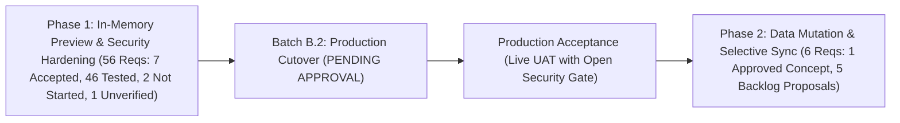
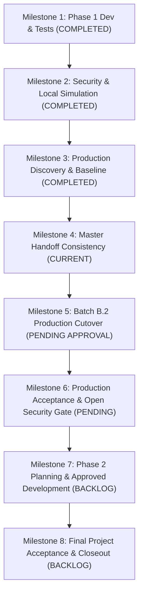

# PROJECT MASTER PLAN — STUDENT INFO LPSEC (ปกศ ๒๕๖๙)

**โครงการ:** เว็บแอปพลิเคชันระบบสารสนเทศนักเรียน ศูนย์การศึกษาพิเศษประจำจังหวัดลำปาง (Student Information System — LPSEC)  
**หน่วยงาน:** ศูนย์การศึกษาพิเศษประจำจังหวัดลำปาง  
**Repository:** `MrPhacharapon/student-info-lpsec` (Public)  
**PR:** [#1 (feature/set-integration-admin-controls)](https://github.com/MrPhacharapon/student-info-lpsec/pull/1)  
**Base Commit (main):** `499c99741b6df634901f71a7eff9313847367f9a`  
**Feature HEAD SHA:** `c39569c82d15ffd1ad8401e8655010c9b9108edb`  
**สถานะเอกสาร:** FINAL CONSISTENCY FIX (ChatGPT Revision 3 Audit Resolution)  
**วันที่ปรับปรุง:** ๑๑ พฤศจิกายน ๒๕๖๙  
**ระดับชั้นความลับ:** สาธารณะ / ภายใน (ห้ามบันทึก Passwords, Secrets, Tokens หรือข้อมูล PII จริงของนักเรียนลงในเอกสารนี้)

---

## ๑. วัตถุประสงค์และเป้าหมายสูงสุดของโครงการ (Project Objectives)

1. **ให้บริการข้อมูลสารสนเทศนักเรียนแก่สาธารณะ (Public Viewer):** เพื่อให้ครู ผู้บริหาร ผู้ปกครอง และหน่วยงานที่เกี่ยวข้องสามารถสืบค้น ดูสถิติภาพรวม กราฟวิเคราะห์ และรายงานข้อมูลนักเรียนที่มีความต้องการจำเป็นพิเศษได้อย่างถูกต้อง สะดวก และรวดเร็วผ่าน Web Browser
2. **ระบบบริหารจัดการข้อมูลสำหรับผู้ดูแลระบบ (Admin Workspace):** ให้ผู้ดูแลระบบที่ได้รับอนุญาตสามารถเข้าสู่ระบบเพื่อแก้ไขข้อมูลนักเรียน เพิ่มนักเรียนใหม่ ลบข้อมูล จัดการห้องเรียน และตั้งค่าการแสดงผลได้ โดยมีระบบรักษาความปลอดภัยตามมาตรฐานสากล
3. **ระบบนำเข้าและเปรียบเทียบข้อมูลจากระบบ SET (SET Excel Import & Admin Preview):** รองรับการนำเข้าไฟล์รายงาน Excel (`.xls`, `.xlsx`) จากระบบสารสนเทศทางการศึกษาพิเศษ (SET) เพื่อตรวจสอบ เปรียบเทียบ และกระทบยอดกับฐานข้อมูล Google Sheets โดยทำงานในหน่วยความจำ (In-Memory Preview 100%) ในระยะที่ ๑ เพื่อป้องกันการเขียนทับข้อมูลจริงโดยไม่เจตนา
4. **ความมั่นคงปลอดภัยและการคุ้มครองข้อมูลส่วนบุคคล (Security & PDPA Hardening):** ยกระดับการยืนยันตัวตนของผู้ดูแลระบบด้วย Salted PBKDF2-HMAC-SHA256 (600,000 รอบ), Ephemeral Signed HMAC Session Token (อายุ 15 นาที), สวิตช์นิรภัย `ENABLE_WRITES` (Fail-Closed Guard) และการปกปิดเลขประจำตัวประชาชน (PII Masking)
5. **การรักษาความสมบูรณ์ของฐานข้อมูลเดิม (Database & Formula Integrity):** ทำงานร่วมกับ Google Sheets โครงสร้างเดิม (ทั้งผังเดิม 16 คอลัมน์ และผังใหม่ 17 คอลัมน์) โดยไม่ทำให้สูญเสียสูตรคำนวณอายุ ไม่ทำให้แถวเคลื่อน และป้องกันปัญหาชื่อซ้ำซ้อนอย่างเด็ดขาด
6. **ระบบการปรับปรุงและประสานข้อมูลในระยะที่ ๒ (Phase 2 Data Mutation & Reconciliation):** พัฒนาระบบให้ผู้ดูแลระบบตรวจสอบรายชื่อคงค้าง ๒๖ รายการ (13 ใหม่ใน SET, 13 มีเฉพาะบนเว็บ) เป็นรายบุคคล พร้อมเลือกปรับปรุงข้อมูลเฉพาะฟิลด์ที่ต้องการ (Selective Sync) อย่างปลอดภัย

---

## ๒. การแบ่งระยะการดำเนินงานและขอบเขตงาน (Lifecycle Scope Partitioning)

โครงการถูกแบ่งขอบเขตงานออกเป็น ๔ ช่วงอย่างชัดเจน เพื่อความปลอดภัยสูงสุดของข้อมูลนักเรียนจริง:

### ๒.๑ ระยะที่ ๑: Phase 1 — In-Memory Preview & Security Hardening (รวม ๕๖ ข้อกำหนด)
- **Public Viewer Module (๙ ข้อกำหนด):**
  - สรุปสถิตินักเรียน 246 ราย, กราฟสถิติ Chart.js ฟอนต์ Sarabun, ตารางรายชื่อ, ตัวกรองข้อมูลหลายระดับ, Pivot Table, Scrollbar คู่, วันที่รายงาน พ.ศ. (`REQ-PUB-01` ถึง `REQ-PUB-08`: `ACCEPTED` 7 ข้อ, `REQ-PUB-06`: `TESTED` 1 ข้อ)
  - การควบคุมเปิด-ปิดเมนูหลักและหัวข้อแสดงผล (`REQ-PUB-09`: `UNVERIFIED` — โค้ดมีปุ่มเปิด-ปิด 4 จุด ได้แก่ `toggleNavStudents`, `toggleNavPivot`, `btnToggleAdvancedSearch`, `btnTogglePiiMask` แต่รายการชื่อ 12 หัวข้อไม่มีเอกสารนิยามต้นฉบับรองรับ `MISSING_SOURCE`)
- **Admin Workspace & Security Hardening (๑๙ ข้อกำหนด):**
  - เข้าสู่ระบบ Admin ด้วย PBKDF2-HMAC-SHA256 600,000 รอบ และ pure-JS UTF-8 normalization บน GAS V8 (`REQ-ADM-01`, `REQ-ADM-02`, `REQ-SEC-02`, `REQ-SEC-03`: `TESTED`)
  - ระบบเซสชันชั่วคราว Ephemeral HMAC Token 15 นาที พร้อมเพิกถอนเซสชันทันทีเมื่อ Logout ผ่าน `TOKEN_EPOCH` bump (`REQ-ADM-03`, `REQ-ADM-04`: `TESTED`)
  - บังคับตรวจ Token ในทุกคำสั่งเขียน (`REQ-ADM-05`: `TESTED`)
  - สวิตช์นิรภัย `ENABLE_WRITES` ปฏิเสธการเขียนแบบ Fail-Closed เมื่อค่าไม่ใช่ `'true'` (`REQ-ADM-06`: `TESTED`)
  - ฟังก์ชันตั้งค่ารหัสผ่าน Admin (`REQ-ADM-09`: `TESTED` — หมายเหตุ: เอนโทรปีของ `Utilities.getUuid()` บน GAS เป็น `UNVERIFIED` แนะนำสร้าง Secret ด้วย CSPRNG ภายนอก)
  - การตั้งค่าระบบและวันที่รายงาน (`REQ-ADM-07`, `REQ-ADM-10`: `TESTED`)
  - ยกเลิกการอ่านรหัสผ่านจาก `security!B1`, ลบ Hardcoded IDs (`REQ-SEC-01`, `REQ-SEC-06`: `TESTED`)
  - ยืนยันการไม่มี Endpoint `stagingInitAndTest` ทั้งใน PR #1 และใน Production Version 4 (`REQ-SEC-07`: `TESTED`)
  - นโยบาย Zero-PII ใน Logs และเอกสารเปิดเผยสาธารณะ (`REQ-SEC-08`: `TESTED` — ตรวจสอบและบังคับใช้อย่างต่อเนื่อง)
  - การป้องกัน Brute-force / Rate Limiting (`REQ-SEC-09`: **`ACCEPTED (USER_RISK_ACCEPTED)`** — **ผ่าน Open Security Gate แล้ว**: ผู้ใช้ได้ให้คำตัดสินยอมรับความเสี่ยงอย่างเป็นทางการเมื่อ ๑๑ พ.ย. ๒๕๖๙ ["ยอมรับความเสี่ยงนี้"])
- **SET Excel Import & Admin Preview Module (๑๙ ข้อกำหนด):**
  - นำเข้าไฟล์รายงาน SET จริง (.xls ตาราง HTML) ผ่าน SheetJS 0.20.3 ทั้งแบบ 2 รายงาน และ 3 รายงาน (`REQ-SET-01`, `REQ-SET-19`: `TESTED`)
  - ตรวจจับแถวหัวตารางอัตโนมัติ ข้ามแบนเนอร์ชื่อรายงาน (`REQ-SET-02`: `TESTED`)
  - รองรับ Alias `"เลข 13 หลัก"` สำหรับ Citizen ID และแยกกับ Student ID เด็ดขาด (`REQ-SET-03`, `REQ-SET-18`: `TESTED`)
  - คงเลขศูนย์นำหน้า (Leading Zeros) ของรหัสนักเรียนและเลขประชาชน (`REQ-SET-04`: `TESTED`)
  - รวมข้อมูล 3 รายงานเป็น 259 รายการไม่ซ้ำ และจัด 6 กลุ่มเปรียบเทียบ (`REQ-SET-05`, `REQ-SET-06`: `TESTED`)
  - แยกความเชื่อมั่น `Verified Match` vs `Predicted Match` (`REQ-SET-07`: `TESTED`)
  - ป้องกันการชนกันของข้อมูล (Collision) และปฏิเสธความสัมพันธ์ขัดแย้งในตารางเชื่อมโยง (`REQ-SET-08`, `REQ-SET-09`: `TESTED`)
  - แยกประเภทความพิการ 3 แหล่งอิสระ (SET vs บัตร vs คัดกรอง) (`REQ-SET-10`: `TESTED`)
  - โมดอลเปรียบเทียบเคียงข้าง (Side-by-Side Diff Modal) พร้อมซ่อน PII เป็นค่าเริ่มต้น (`REQ-SET-11`, `REQ-SEC-04`, `REQ-SEC-05`: `TESTED`)
  - ชี้แจงข้อความกลุ่ม `sheets_only` เป็น "รอตรวจสอบ" ไม่ใช่ "(ซ่อน)" (`REQ-SET-12`: `TESTED`)
  - ประมวลผลในหน่วยความจำ 100% ไม่ส่งคำสั่งเขียนข้อมูลกลับ Google Sheets ใน Phase 1 (`REQ-SET-13`: `TESTED`)
  - ปุ่มโหลดชุดข้อมูลจำลอง (Mock Data) (`REQ-SET-14`: `TESTED`)
  - กฎจัดการข้อมูลไม่ทับซ้อน: คงสถานะนักเรียน SET-only (13 ราย) และ Sheets-only (13 ราย) รอตรวจสอบ ห้ามเพิ่ม/ลบอัตโนมัติ (`REQ-SET-15`: `TESTED`)
  - การตรวจสอบเลข 13 หลักตาม Modulo 11 Checksum และรหัส G-Code (`REQ-SET-16`: `TESTED`)
  - การแปลงวันที่และคำนวณอายุสัมพัทธ์กับวันรายงาน (`REQ-SET-17`: `TESTED`)
- **Google Sheets Compatibility Backend (๙ ข้อกำหนด):**
  - รองรับทั้งผังเดิม 16 คอลัมน์ และผังใหม่ 17 คอลัมน์ (`REQ-SHT-01`, `REQ-SHT-02`: `TESTED`)
  - ตรวจจับหัวตารางและแถวข้อมูลอัตโนมัติ ตรวจจับหัวตารางย่อยจริง (`REQ-SHT-03`, `REQ-SHT-04`: `TESTED`)
  - รักษาสูตรคำนวณอายุและปรับเลขอ้างอิงอัตโนมัติ (`REQ-SHT-05`: `TESTED`)
  - ค้นหาแถวตามตัวตน (`findTargetStudentRow`) ป้องกันชื่อซ้ำ และป้องกันการเขียนทับรหัสว่าง (`REQ-SHT-06`, `REQ-SHT-07`, `REQ-SHT-08`: `TESTED`)
  - การสำรองข้อมูลชีตก่อนการ Cutover (`REQ-SHT-09`: **`ACCEPTED`** — ตรวจสอบพบแท็บสำรอง 'พย69 ก่อนใส่รหัส+ซ่อมชื่อ' ในชีตจริงเรียบร้อยแล้ว)

### ๒.๒ ขั้นตอนการ Cutover สู่ Production: Batch B.2 (สถานะ: รอการอนุมัติหลัง ChatGPT Review)
- ให้ผู้ดูแลระบบคัดลอกแท็บ `ต.ค.69` บน Google Sheets จริงเป็น `ต.ค.69_pre_cutover_backup` เพื่อเป็นหลักประกันข้อมูล
- ตรวจสอบ Project Settings UI ของ `10JFFSdKAM...` และตั้งค่า Script Properties 6 รายการ โดยใช้ CSPRNG ภายนอกสร้าง Secret และตั้ง `ENABLE_WRITES=false`
- อัปเดตโค้ดเซิร์ฟเวอร์บน Google Apps Script เป็น **Version 5** (โดยแทนที่โค้ดลงในไฟล์ `"รหัส"` เดิมเพื่อป้องกัน Duplicate Function Collision)
- ทำการทดสอบ GET API บน Production ยืนยันข้อมูล 246 รายการ และทดสอบ Fail-Closed (คำสั่งเขียนต้องถูกปฏิเสธด้วย `WRITES_DISABLED`)
- Merge Pull Request #1 สู่ Branch `main`
- Vercel Auto-deploy Production Web App
- ทดสอบ Public Viewer และ Admin Login บน Production URL
- ปรับ `ENABLE_WRITES=true` บน Script Properties เพื่อเปิดใช้งานคำสั่งเขียนของผู้ดูแลระบบตามปกติ

### ๒.๓ การตรวจรับงานระยะที่ ๑ (Production Acceptance & Live UAT)
- ตรวจสอบระบบสดบน Production ร่วมกับผู้ใช้
- **เกณฑ์การตรวจรับ Phase 1 (M6 Criteria):**
  - ข้อกำหนดที่อยู่ในสถานะ `TESTED` จำนวน 46 ข้อ และ `REQ-SHT-09` (เมื่อดำเนินการ Backup สำเร็จ) จะได้รับการประเมินเป็น `ACCEPTED`
  - **Open Security Gate (`REQ-SEC-09`):** ผู้ใช้ได้ให้คำตัดสินยอมรับความเสี่ยง (User Risk Acceptance) อย่างเป็นทางการเป็นลายลักษณ์อักษรแล้วเมื่อ ๑๑ พ.ย. ๒๕๖๙ ("ยอมรับความเสี่ยงนี้") สำหรับรหัสผ่าน 3 ตัวอักษรและการไม่มี Rate Limiting ทำให้ผ่านเกณฑ์ความปลอดภัยของ Phase 1 เรียบร้อยแล้ว
  - ข้อกำหนด `REQ-PUB-09` จะคงสถานะ `UNVERIFIED` เว้นแต่ผู้ใช้จะระบุเอกสารนิยาม 12 หัวข้อที่ชัดเจน

### ๒.๔ ระยะที่ ๒: Phase 2 — Data Mutation & Selective Sync (รวม ๖ ข้อกำหนด — สถานะ: BACKLOG)
- พัฒนาแผงตรวจสอบตัวตนนักเรียนคงค้าง ๒๖ รายการแบบรายบุคคล (`REQ-MUT-01`: ได้รับอนุมัติแนวคิดตาม User Directive Nov 10, 2026)
- ข้อเสนอทางเทคนิคของ AGT ที่รอการตัดสินใจจากผู้ใช้ (`AGT Technical Proposals`):
  - ระบบเลือกฟิลด์ข้อมูลที่ต้องการปรับปรุงลงชีตจริง (Selective Field Sync) (`REQ-MUT-02`)
  - ระบบนำเข้านักเรียนใหม่จาก SET เข้าชีตจริงแบบกลุ่ม (Batch Insert) พร้อมสูตรคำนวณอายุ (`REQ-MUT-03`)
  - ระบบจัดการสถานะนักเรียนที่มีเฉพาะในชีต (ย้ายออก, สำเร็จการศึกษา, พักการเรียน) โดยไม่ลบประวัติ (`REQ-MUT-04`)
  - ระบบสำรองข้อมูลชีตอัตโนมัติก่อนการ Sync ก้อนใหญ่ (Automated Pre-Sync Snapshot) (`REQ-MUT-05`)
  - ระบบบันทึกประวัติการนำเข้าและแก้ไขข้อมูล (Audit Trail / Activity Log) สำหรับ Admin (`REQ-MUT-06`)
  - ⚠️ *ข้อกำหนด `REQ-MUT-02..06` จะต้องได้รับการตัดสินใจอย่างเป็นทางการจากผู้ใช้ (`APPROVED`, `DEFERRED` หรือ `REJECTED`) ก่อนนำเข้าสู่ขอบเขตการพัฒนาจริง*

---

## ๓. ข้อตกลงการตัดสินใจเชิงสถาปัตยกรรม (Architectural Decision Records - ADRs)

| รหัส ADR | หัวข้อการตัดสินใจ | มติและหลักการเชิงเทคนิค |
| :--- | :--- | :--- |
| **ADR-01** | คงสถาปัตยกรรมหลักเดิม | ยืนยันใช้ **Vercel Frontend (HTML/JS) + Google Apps Script (V8) + Google Sheets** ต่อไป ไม่อนุญาตให้ย้าย Database หรือเปลี่ยนบริการโฮสต์ |
| **ADR-02** | ประมวลผล SET Import ในหน่วยความจำ | ประมวลผลแบบ Client-side In-Memory ด้วย SheetJS `0.20.3` เพื่อลดภาระเซิร์ฟเวอร์ GAS ป้องกัน Timeout และตัดความเสี่ยงข้อมูลจริงรั่วไหลหรือถูกเขียนทับ |
| **ADR-03** | เข้ารหัสผ่าน Admin ด้วย PBKDF2 บน GAS | ใช้ pure-JavaScript **PBKDF2-HMAC-SHA256 (600,000 รอบ)** ตามมาตรฐาน OWASP บน Google Apps Script V8 พร้อม pure-JS UTF-8 normalization *(หมายเหตุโควตา: โควตาประมวลผลทั่วไปของสคริปต์ GAS คือ 6 นาทีต่อการรัน ไม่ใช่ 30 วินาที อย่างไรก็ตาม เวลาทำงานจริงบน GAS ยังเป็น `UNVERIFIED` และมีความเสี่ยงด้าน Client-side/Network Timeout และผลกระทบต่อ UX)* |
| **ADR-04** | ระบบเซสชันชั่วคราว HMAC Token | ใช้ **HMAC-SHA256 Signed Token** ชั่วคราว (อายุ 15 นาที) ลงนามด้วย `ADMIN_HMAC_SECRET` และตรวจสอบ `TOKEN_EPOCH` ใน Script Properties *(คำแนะนำ CSPRNG: เอนโทรปีของ `Utilities.getUuid()` บน GAS ยังเป็น `UNVERIFIED` จึงแนะนำให้สร้าง Secret ขนาด 32 ไบต์ ด้วย CSPRNG ภายนอกก่อนบันทึกใน Script Properties)* |
| **ADR-05** | สวิตช์นิรภัย Fail-Closed Write Guard | กำหนดตัวแปร `ENABLE_WRITES` ใน Script Properties หากไม่มีค่าหรือไม่ใช่ `'true'` ให้ปฏิเสธคำสั่งเขียนทุกกรณีทันที (`code: 'WRITES_DISABLED'`) |
| **ADR-06** | ระบุ Production GAS Target ที่แท้จริง | สคริปต์เป้าหมายจริงคือ Container-bound Script **`10JFFSdKAM3YXjdzVsrqerA7DDlZvqefrVS1RlcTkyqdF-NkeX8d7ffrG`** Deployment ID `AKfycbxcXbd-XhedWvE9c1b6Syl763fqU1fm6Oq2RXA6epjanZsZ34AM5RW-QIZssH2ZQdwq` Version 4 (ห้ามใช้สคริปต์เก่า `1Y7Ho83Y...`) |
| **ADR-07** | แยกการส่งมอบ ๒ ระยะอย่างเด็ดขาด | แยก Phase 1 (Preview & Auth Hardening) ออกจาก Phase 2 (Data Mutation) อย่างเด็ดขาด เพื่อความปลอดภัยของข้อมูลนักเรียนจริง |

---

## ๔. แผนงานหลักและหมุดหมายของโครงการ (Project Milestones)

### รายละเอียดและเกณฑ์ตรวจรับของแต่ละ Milestone (Milestones & Acceptance Criteria)

| หมุดหมาย (Milestone) | รายละเอียดงาน | สถานะ | ขอบเขต Requirements ที่เกี่ยวข้อง | เกณฑ์ตรวจรับเชิงประจักษ์ (Acceptance Criteria) |
| :--- | :--- | :---: | :--- | :--- |
| **M1: Phase 1 SET Import & UI** | พัฒนา `set-importer.js`, UI Preview 6 หมวดหมู่, Side-by-side Diff Modal, PII Masking, SheetJS 0.20.3 | **COMPLETED** | `REQ-SET-01..19`, `REQ-PUB-01..08` | ชุดทดสอบ `test_set_importer.js` ครบ 27/27 Suites ผ่าน 100%, ผู้ใช้ UAT บน Preview แสดงผลครบ 6 กลุ่ม |
| **M2: Security Hardening** | พัฒนา PBKDF2 600,000 รอบ, Ephemeral HMAC Token, `ENABLE_WRITES` Fail-Closed, รองรับผังชีต 16/17 Col, รักษาสูตร | **COMPLETED** | `REQ-ADM-01..10`, `REQ-SEC-01..08`, `REQ-SHT-01..08` | ชุดทดสอบ `test_phase2_sheets.js` ครบ 13/13 Scenarios ผ่าน 100%, ผลทดสอบเวกเตอร์ RFC 7914 ตรง 100% |
| **M3: Production Discovery & Baseline** | พิสูจน์ Source of Truth จริง (`10JFFSdKAM...`), แก้ไขข้อเข้าใจผิดของ `.clasp.json`, สำรอง Version 4, ยืนยันสถิติ 246 คน | **COMPLETED** | ADR-06 | สำรองไฟล์ Version 4 (`รหัส`, `appsscript.json`) ใน scratch, ผลเรียก live GET API คืนค่า 246 รายการ |
| **M4: Master Handoff & Project Baseline** | จัดทำ Master Plan, Traceability Matrix (62 ข้อ), Handoff Status ส่งมอบความรู้พร้อม Open Items 8 รายการ | **COMPLETED (APPROVED)** | All 62 Requirements | เอกสารทั้ง 3 ฉบับสอดคล้องกัน 100% (7 Accepted, 46 Tested, 8 Not Started, 1 Unverified, Open Items ครบ 8 รายการ), ได้รับอนุมัติ Project Baseline จากผู้ใช้แล้วอย่างเป็นทางการเมื่อ ๑๑ พ.ย. ๒๕๖๙ |
| **M5: Batch B.2 Production Cutover** | สร้างแท็บสำรอง `ต.ค.69_pre_cutover_backup`, บันทึก Script Properties ด้วย CSPRNG ภายนอก, อัปเดต Version 5, Merge PR #1, เปิดสวิตช์ `ENABLE_WRITES` | **PENDING APPROVAL** | `REQ-ADM-01..06`, `REQ-SEC-01`, `REQ-SHT-09` | Script Properties 6 รายการครบถ้วนบน `10JFFSdKAM...`, Version 5 Active, PR #1 merged, Vercel Production Deploy PASS |
| **M6: Production Acceptance & Open Security Gate** | ตรวจสอบการทำงานของ Live Production ทุกโมดูลร่วมกับผู้ใช้ พร้อมจัดการ Open Security Gate | **PENDING** | `REQ-PUB-01..09`, `REQ-ADM-01..10`, `REQ-SEC-01..09`, `REQ-SET-01..19`, `REQ-SHT-01..09` | ผู้ใช้ทดสอบบน Live Production แล้วยืนยันความถูกต้อง ข้อกำหนดที่ผ่านการทดสอบปรับเป็น `ACCEPTED` และ `REQ-SEC-09` ผ่านเกณฑ์ด้วยคำตัดสิน User Risk Acceptance แล้ว |
| **M7: Phase 2 Planning & Approved Development** | นำเสนอข้อเสนอ Phase 2 ให้ผู้ใช้ตัดสินใจ (`APPROVED` / `DEFERRED` / `REJECTED`) และพัฒนาเฉพาะรายการที่ได้รับอนุมัติ | **BACKLOG** | `REQ-MUT-01..06` | ผู้ใช้มีคำตัดสินอนุมัติขอบเขตงาน และตรวจรับฟังก์ชันการเขียนข้อมูลจริงลงชีต โดยไม่มีข้อมูลสูญหายและสูตรคำนวณอายุทำงานถูกต้อง |
| **M8: Final Closeout** | ส่งมอบโครงการขั้นสุดท้ายร่วมกับผู้ใช้และ ChatGPT | **BACKLOG** | Approved Requirements | ข้อกำหนดที่ได้รับอนุมัติจากผู้ใช้ทั้งหมดอยู่ในสถานะ `ACCEPTED` 100%, ปิดโครงการอย่างเป็นทางการ |

---

## ๕. เกณฑ์การสิ้นสุดโครงการ (Project Completion Criteria)

โครงการจะถือว่าเสร็จสิ้นสมบูรณ์ (Project Complete 100%) ก็ต่อเมื่อผ่านเกณฑ์ครบทั้ง ๑๐ ข้อ:
1. **ข้อกำหนดทั้งหมดที่ได้รับอนุมัติจากผู้ใช้จริง (Approved Requirements)** ใน `REQUIREMENTS_TRACEABILITY.md` อยู่ในสถานะ `ACCEPTED` ครบถ้วน 100% และข้อเสนอเชิงเทคนิค (`REQ-MUT-02..06`) ได้รับการตัดสินใจสถานะอย่างชัดแจ้ง (`APPROVED`, `DEFERRED` หรือ `REJECTED`)
2. ระบบ Public Viewer แสดงผลข้อมูลถูกต้อง ครบถ้วน สอดคล้องกับฐานข้อมูลนักเรียนศูนย์ฯ ลำปาง
3. ระบบ Admin Workspace มีความปลอดภัยตามเกณฑ์มาตรฐาน เข้าสู่ระบบและจัดการข้อมูลได้โดยไม่เกิดข้อผิดพลาด
4. ระบบ SET Import สามารถนำเข้า เปรียบเทียบ และประสานข้อมูลจริงได้อย่างแม่นยำ
5. ฐานข้อมูล Google Sheets มีความสมบูรณ์ ไม่มีข้อมูลสูญหาย และสูตรคำนวณทำงานถูกต้อง
6. ชุดทดสอบ Unit & Regression Tests ทั้งหมดรันผ่าน 100%
7. ระบบบน Production (Vercel + GAS) ทำงานได้อย่างเสถียรต่อเนื่อง
8. ไม่มีข้อบกพร่องระดับวิกฤต (Critical/High Severity Bugs) ตกค้าง และ Open Security Gates ได้รับการจัดการหรือมี User Risk Acceptance
9. เอกสารโครงการทั้งหมด (Master Plan, Traceability, Handoff) เป็นปัจจุบันและตรวจสอบย้อนกลับได้
10. ผู้ใช้และ ChatGPT ให้การตรวจรับโครงการขั้นสุดท้ายอย่างเป็นทางการ
